# 星野 · Android 浏览器

基于系统 WebView，支持 Android 8.0 及以上版本。

[下载 APK](https://github.com/xviapp/web/releases) · [问题反馈](https://github.com/xviapp/web/issues)

## 功能

- 底部地址栏、历史和书签联想、自定义搜索引擎。
- 多标签、关闭撤销、标签恢复、无痕浏览。
- 书签目录、拖动排序、HTML 导入导出。
- 文件和图片下载、断点续传；支持文件上传、拍照和录像。
- 广告拦截、自定义规则和订阅。
- 家长控制：按类别拦截色情、赌博网站，自定义拦截和允许名单，强制安全搜索。
- 用户脚本（油猴脚本），支持从 Greasy Fork 等网站一键安装、自动更新。
- 阅读模式、网页翻译、页内查找、桌面模式、保存网页、打印 / PDF、二维码识别。
- AI 网页总结、图文问答、阅读模式整理和划词处理，需自行配置 DeepSeek 或兼容 OpenAI 接口的服务及 API Key。
- 网站桌面快捷方式、独立窗口、视频画中画和后台播放。
- 网站权限、深色模式、数据清理、备份恢复、SOCKS5 / HTTP 代理。

## 截图

<table>
<tr><td align="center" width="33%">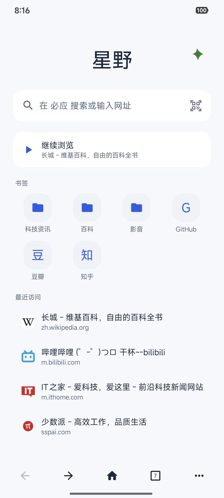<br><b>首页</b><br><sub>继续浏览、书签和最近访问</sub></td><td align="center" width="33%">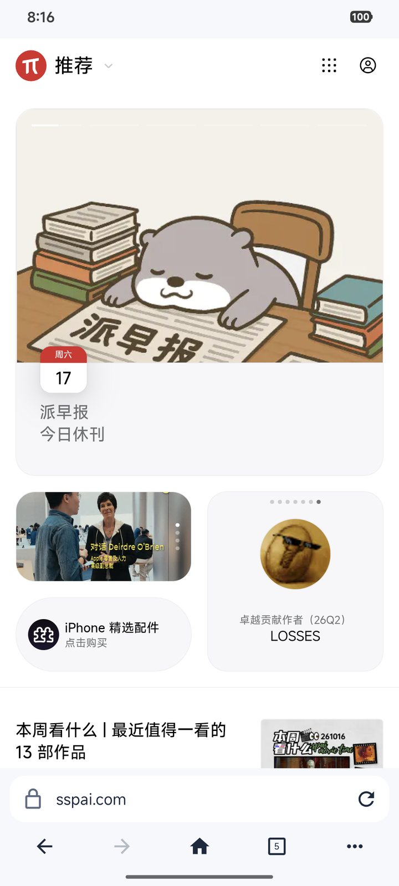<br><b>浏览网页</b><br><sub>地址栏和工具栏在底部</sub></td><td align="center" width="33%">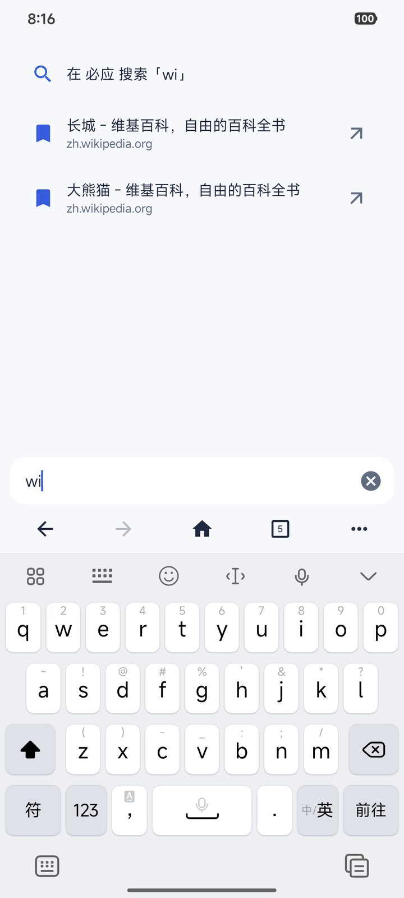<br><b>地址栏联想</b><br><sub>匹配书签和历史</sub></td></tr>
<tr><td align="center" width="33%">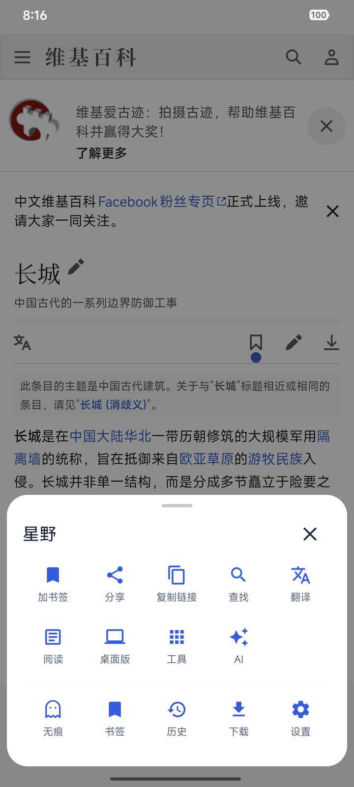<br><b>菜单</b><br><sub>常用操作一屏排开</sub></td><td align="center" width="33%">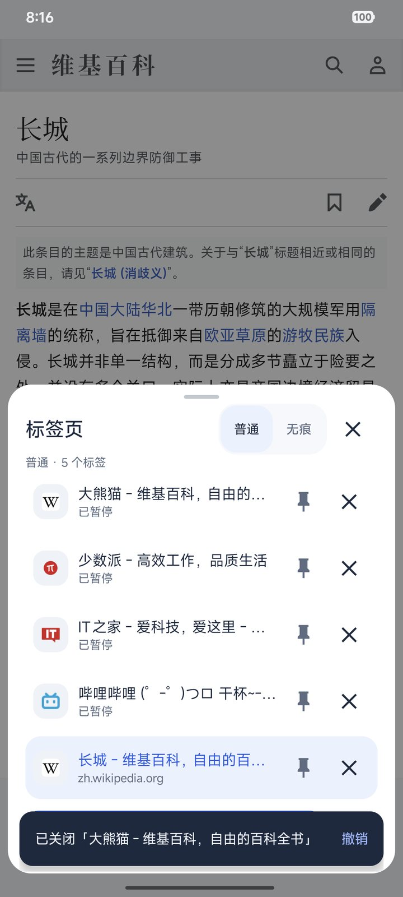<br><b>多标签页</b><br><sub>后台标签暂停，关闭可撤销</sub></td><td align="center" width="33%">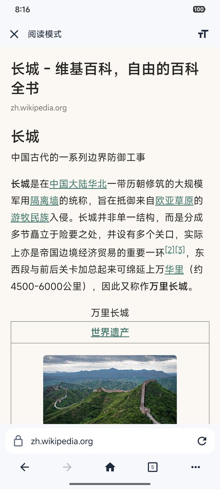<br><b>阅读模式</b><br><sub>只留正文</sub></td></tr>
<tr><td align="center" width="33%">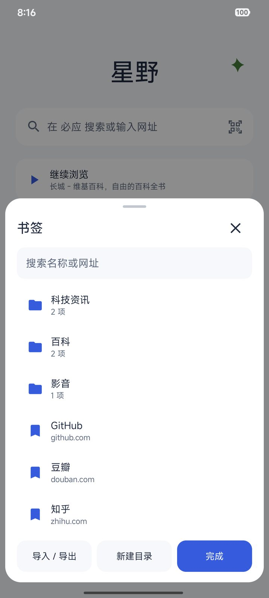<br><b>书签</b><br><sub>目录、排序、导入导出</sub></td><td align="center" width="33%">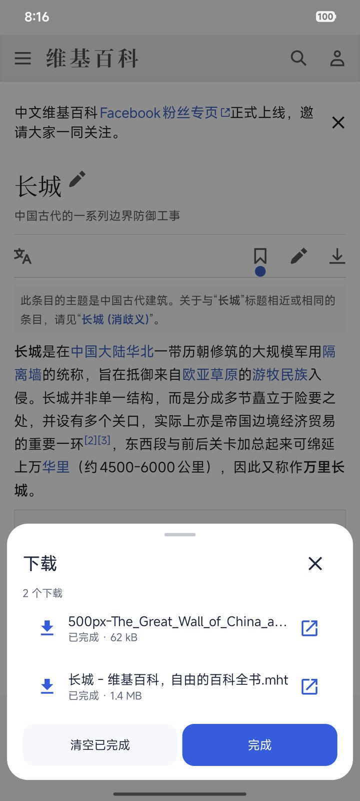<br><b>下载管理</b><br><sub>支持断点续传</sub></td><td align="center" width="33%">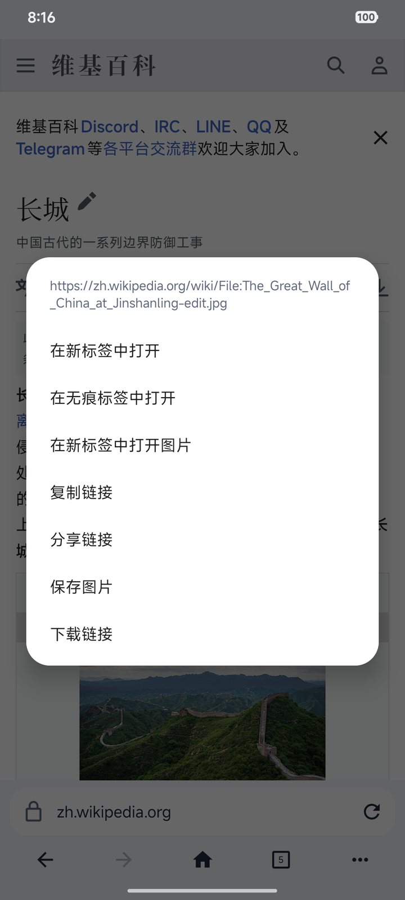<br><b>长按菜单</b><br><sub>链接和图片操作</sub></td></tr>
<tr><td align="center" width="33%">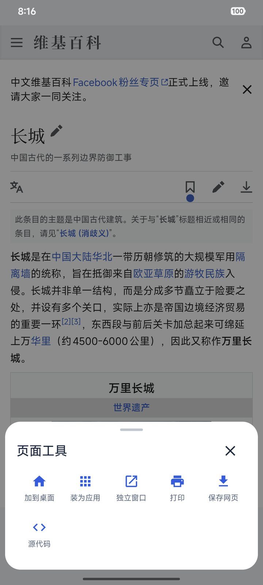<br><b>页面工具</b><br><sub>加到桌面、独立窗口、打印</sub></td><td align="center" width="33%">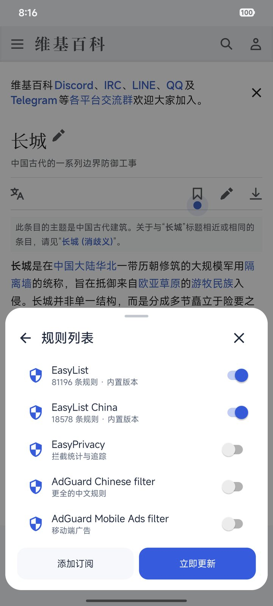<br><b>广告拦截</b><br><sub>内置规则和订阅</sub></td><td align="center" width="33%">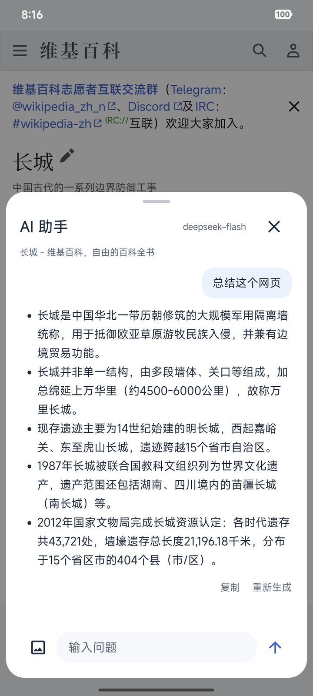<br><b>AI 总结</b><br><sub>提炼网页要点</sub></td></tr>
<tr><td align="center" width="33%">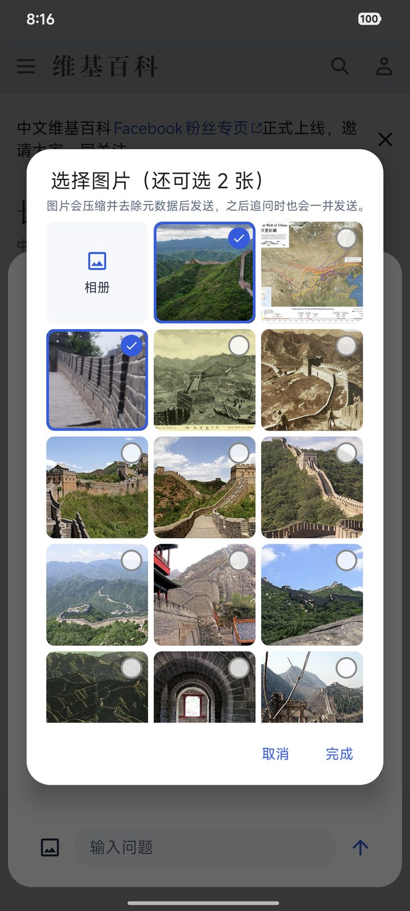<br><b>AI 图文问答</b><br><sub>勾选网页图片一起提问</sub></td><td align="center" width="33%">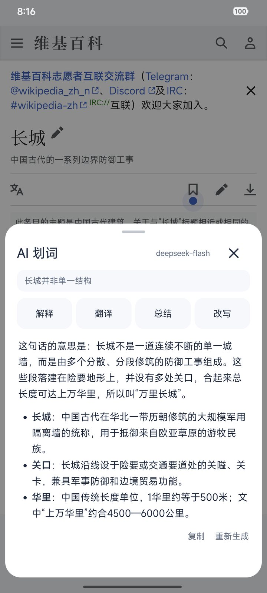<br><b>AI 划词</b><br><sub>解释、翻译、总结、改写</sub></td><td align="center" width="33%">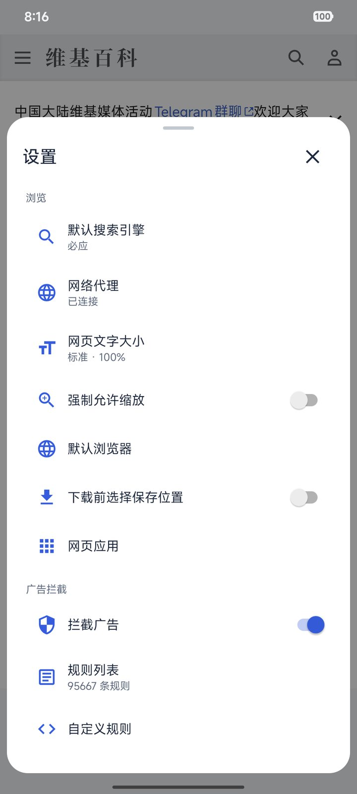<br><b>设置</b><br><sub>搜索引擎、代理、网页应用</sub></td></tr>
<tr><td align="center" width="33%">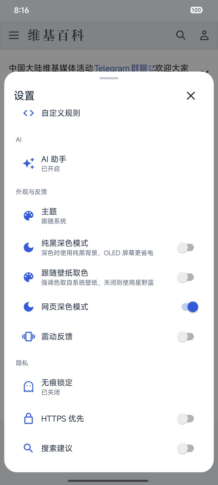<br><b>外观与隐私</b><br><sub>主题、HTTPS 优先、退出清除</sub></td><td align="center" width="33%">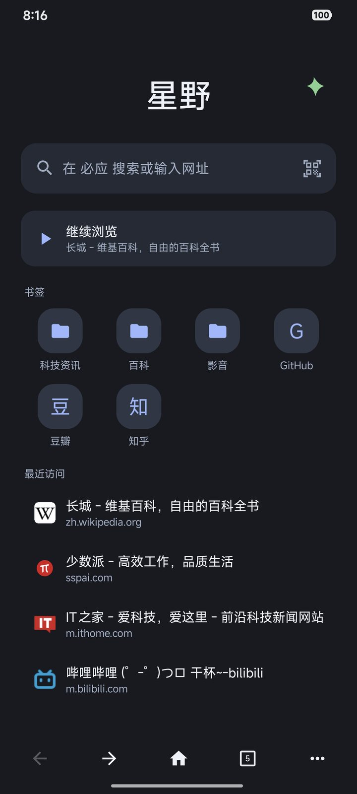<br><b>深色模式</b><br><sub>界面整体变暗</sub></td><td align="center" width="33%">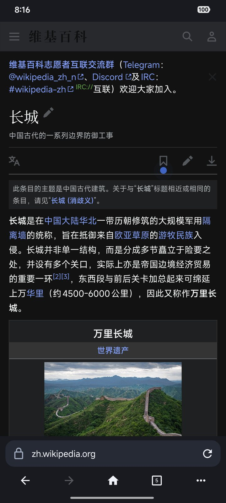<br><b>深色网页</b><br><sub>网页随界面变暗</sub></td></tr>
</table>

截图中的 AI 功能需自行配置服务和 API Key。

## 使用说明

### 代理

在「设置 → 代理」填写本机或局域网代理地址并开启，例如 `socks5://127.0.0.1:7890`。浏览器不内置代理服务。

- 支持 `socks5://主机:端口` 和 `http://主机:端口`，省略协议时按 SOCKS5 处理；不支持账号密码或 HTTPS 代理。
- 本机和局域网地址直连，不保证代理 WebRTC UDP 等流量。
- 代理不可用时自动直连并提示，恢复后切回代理。已开始的下载沿用原线路。
- 开启「连接 VPN 时直连」后，本应用经过 VPN 时不再使用所配置的代理。

### AI 图文问答

打开 AI 面板不会自动请求 AI，点「总结这个网页」、自定义指令或直接提问时才发送。点「添加图片」可勾选网页图片或从相册选择，每次最多 4 张，每段对话最多 12 张。

图片压缩并去除元数据后发送，之后追问时也会一并发送，AI 服务不会访问图片所在网站。图片只保存在当前标签的内存中。需要所选模型支持识图，如 deepseek-flash。

### AI 阅读模式

阅读模式找不到正文时，可以点「用 AI 整理」；已经打开的阅读模式也可以点顶部的 AI 按钮重新整理。AI 只负责挑选哪些段落属于正文，不改写文字，显示的仍是网页原文，经过与普通阅读模式相同的安全过滤。

发送给 AI 的是网页各段内容的开头片段、标题和网址，不发送完整正文。同一页面再次整理会使用上次的结果，无痕页面不保留结果。只能整理页面上已经加载的内容。

### 用户脚本

在 Greasy Fork 等网站点击 `.user.js` 安装链接即可安装，也可在「设置 → 用户脚本」从网址安装或新建脚本。安装或修改后，刷新页面生效。菜单「工具 → 脚本」可查看并开关匹配当前页面的脚本。

- 支持 `@match`、`@include`、`@exclude`、`@run-at`、`@noframes`、`@require`、`@resource`、`@connect`。
- 支持 `GM_getValue` / `GM_setValue` / `GM_deleteValue` / `GM_listValues`、`GM_addValueChangeListener`、`GM_addStyle`、`GM_info`、`GM_xmlhttpRequest`、`GM_registerMenuCommand`、`GM_openInTab`、`GM_setClipboard`、`GM_notification`、`GM_download`、`GM_getResourceText` / `GM_getResourceURL`，以及对应的 `GM.*` 写法。暂不支持 `GM_cookie`、`GM_webRequest`、`GM_getTab` 等。
- `GM_xmlhttpRequest` 经浏览器的代理设置发出，默认带上目标网站的 Cookie（`anonymous: true` 时不带）。脚本可直接访问当前网站和 `@connect` 列出的网站；访问其他网站时会询问，可选总是允许、仅本页或拒绝。已允许的网站可在脚本菜单中清除。
- 脚本注册的菜单命令显示在「工具 → 脚本」中。脚本打开标签和下载文件有频率限制，通知以页面底部提示显示。
- 脚本与网页运行在同一环境中，可以读取和修改匹配网站的内容，包括已登录的页面。请只安装信任的脚本。
- 无痕标签默认不运行脚本，可按脚本单独允许。脚本在无痕标签中保存的数据只留在内存中，关闭无痕后丢弃；发出的请求只带无痕会话自己的 Cookie。网页应用中会照常运行。
- `@require` 和 `@resource` 在安装时下载，运行时不再联网获取。每周检查一次脚本更新。
- 需要 WebView 支持文档开始脚本，旧版本需先更新 Android System WebView。

### 家长控制

在「设置 → 家长控制」开启。开启某个类别后会下载对应的拦截列表，之后每周自动更新；列表下载成功前，该类别不会拦截。

- 被拦截的网站不会加载，页面上会说明原因。这些网站嵌在其他页面中的图片、视频和框架也会被拦截，不受广告拦截开关和单个网站设置影响。
- 可以补充额外拦截的网站，或把误拦的网站加入始终允许名单。名单中的网站同时包括它的子域名。
- 强制安全搜索会让 Google、必应和 DuckDuckGo 只显示过滤后的结果。百度没有对应的开关。
- 打开「修改前验证身份」后，进入家长控制设置需要验证手机锁屏。家长控制设置不写入备份，恢复备份不会改变它。
- 拦截基于公开的域名列表，无法覆盖所有网站，也无法拦截综合性网站上的部分内容。它不能代替系统级的家长控制。

### 隐私与数据

- 浏览数据保存在本机，无账号和云同步。应用不使用 Android 自动备份，可在「设置 → 数据」手动备份；勾选 AI 密钥后，密钥会以明文写入备份文件。
- 无痕浏览隔离 Cookie 和网站存储，不保存历史、标签恢复和下载记录。关闭全部无痕标签后清理会话，异常退出遗留数据在下次启动清理。主动保存的书签和下载文件仍会保留。
- 无痕浏览不能隐藏网站、网络服务、代理或 AI 服务端的记录。部分旧版 WebView 不支持无痕浏览，需更新后使用。
- 搜索联想默认关闭，开启后会将输入发送给搜索引擎；无痕模式不请求联想。网页翻译会将页面地址发送给 Google。
- AI 网页问答会向所配置的服务发送正文、标题、网址和对话，以及你选择的图片；划词会发送选中文字，并可能附带所在段落或标题。请求可能消耗 API 额度。首次发送、更换服务及每次无痕发送前会询问。
- 网页应用与普通浏览共用登录状态。清除网站数据会退出相关网站的登录。

完整隐私说明见「设置 → 关于星野」。

### 使用限制

- 最多 50 个标签。内存不足时会释放后台页面；内存充足时，最近用过的 4 个以外、超过 30 分钟没看的后台页面也会释放。重要页面可手动固定；重启后只恢复普通标签信息。
- 最多同时下载 3 个文件，续传需要服务器支持。`blob:` / `data:` 文件上限为 200 MB，`blob:` 下载需保留来源页面。不支持视频嗅探。
- 后台播放和下载仍可能被系统结束。

## 构建

需要 JDK 21、Android SDK Platform 37 和 Build Tools。脚本测试需要 Node.js，无需安装 npm 依赖。通过 `ANDROID_HOME` 或 `local.properties` 中的 `sdk.dir` 指定 SDK 路径。

```sh
./gradlew :app:assembleDebug
npm test
npm run lint
```

发布版：

```sh
npm run build:android:release
```

发布包输出到 `app/build/outputs/releases/<版本>/`，文件名为 `app.xvi.web-<版本>-universal.apk`，附 `SHA256SUMS` 校验文件。

发布版需在 `.signing/release.properties` 中配置 `storeFile`、`storePassword`、`keyAlias`、`keyPassword`，使用 PKCS12 密钥。请妥善备份签名文件。

### 设备测试

设备测试会修改浏览数据。使用 `.verify` 后缀安装独立副本：

```sh
./gradlew :app:assembleDebug :app:assembleDebugAndroidTest -PwebIdSuffix=.verify
adb install -r -t app/build/outputs/apk/debug/app-debug.apk
adb install -r -t app/build/outputs/apk/androidTest/debug/app-debug-androidTest.apk
adb shell am instrument -w app.xvi.web.verify.test/androidx.test.runner.AndroidJUnitRunner
```

无痕用例会在 WebView 不支持时跳过。Android 16 上，`BrowserIntegrationTest` 的两个本地下载用例可能挂起，可单独运行其他用例。

## 许可证

原创代码采用 [MIT](LICENSE)，第三方依赖和资源见[第三方声明](THIRD_PARTY_NOTICES.md)。
